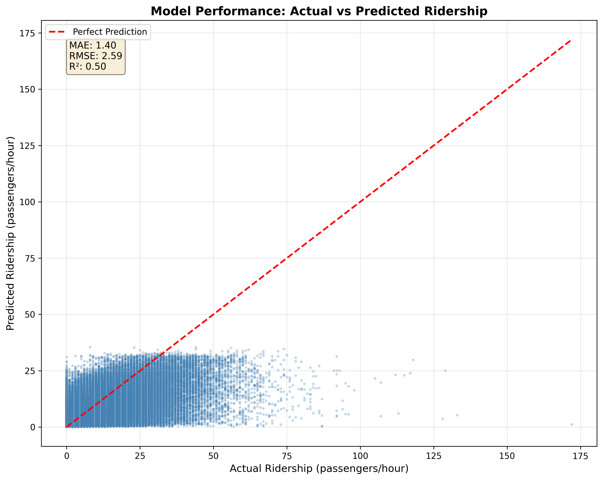

## Bus Ridership Prediction in Trondheim

Machine learning pipeline for forecasting public transport demand. 

## Business Problem
Public transport operators face the challenge of balancing service quality with operational costs. Running buses on unpredictable demand leads to either empty buses wasting fuel and driver hours, or overcrowded buses creating poor passenger experience.This project explores whether machine learning can provide actionable ridership forecasts to support better scheduling decisions in Trondheim's bus network operated by ATB (AtB - Trøndelag public transport).

**Tech Stack**: Python • Random Forest • Scikit-learn • Pandas • Frost API

## Model Performance
Mean Absolute Error (MAE): 1.40 passengers per hour per stop
RMSE: 2.59 passengers per hour
R² Score: 0.50 (explains 50% of ridership variance)
Training Data: 4.2M+ hourly ridership records from ATB (2024)

*Scatter plot of predicted vs. actual ridership. Points near the red diagonal indicate accurate predictions. The model performs best for typical volumes (0-30 passengers/hour), which represent the majority of observations.*

## What This Means in Practice
The model captures approximately half of the patterns in bus ridership, with predictions typically within 1-2 passengers of actual values.

## Model Strengths:
-Highly accurate for typical stop volumes (0-30 passengers/hour)
-Captures temporal patterns (rush hours, weekends, holidays)
-Weather and event features contribute measurably to predictions
-Strong performance on high-traffic stops with consistent patterns

## Model Limitations:
-Tends to underpredict extreme high-volume events
-Performance varies by stop type (high-traffic stops more predictable)
-Best suited for aggregate route planning rather than precise stop-level scheduling
-Does not capture all sources of ridership variation

## Baseline Comparison
The model represents a meaningful improvement over naive baseline approaches:

-Simple hourly averages fail to capture day-to-day variation
-Rolling averages cannot anticipate special events
-This model integrates weather, events, and learned temporal patterns

## Project Overview
This is a comprehensive machine learning project for predicting bus ridership in Trondheim, Norway, using ATB (public transport) data. The project implements a complete Random Forest regression pipeline that predicts passenger boardings based on temporal patterns, weather conditions, and local events.

## Key Features:

-Automated 7-step ML pipeline from raw data to business insights
-Integration with Norwegian Meteorological Institute API
-Comprehensive event calendar (RBK games, festivals, holidays)
-Feature engineering with temporal, lag, and rolling statistics
-Hyperparameter optimization via cross-validation
-Business impact analysis and model interpretability

## Quick Start

# Clone repository
git clone https://github.com/oyvinds78/trondheim-bus-ridership-prediction.git
cd trondheim-bus-ridership-prediction

# Create virtual environment
python -m venv venv
venv\Scripts\activate  # On Windows
source venv/bin/activate  # On Linux/Mac

# Install dependencies
pip install -r requirements.txt

# Validate setup
python complete_pipeline.py --check-status

### Complete Pipeline

## Running the full pipeline

# Check pipeline status and file requirements
python complete_pipeline.py --check-status

# Run full pipeline from beginning
python complete_pipeline.py

# Start from specific step (0-based indexing)
python complete_pipeline.py --start-from 3

# Run specific range of steps
python complete_pipeline.py --start-from 2 --stop-at 5

_________________________________________________________________

### 7-Step ML Pipeline
The pipeline executes these steps in sequence:

1. Weather Data Collection (src/retrieve_hourly_weather.py)

Fetches hourly meteorological data from frost.met.no API
Temperature, wind, precipitation, humidity

2. Event Feature Building (src/event_feature_builder.py)

Creates binary indicators from events_config.json
RBK home games, major festivals, holidays, school breaks

3. Master Dataset Building (src/master_dataset_builder.py)

Integrates ridership, weather, and event data
Validates data quality and handles missing values

4. Feature Engineering (src/feature_engineered_RF.py)

Temporal features (hour, day, cyclical encoding)
Lag features (previous hour, previous week)
Rolling statistics (3-hour windows)

5. Hyperparameter Tuning (src/hyperparameter_tuning_RF.py)

Optimizes Random Forest parameters via cross-validation
Grid search over n_estimators, max_depth, min_samples_leaf

6. Final Model Training (src/train_final_model.py)

Trains optimized model on full training dataset
Saves model with metadata and feature list

7. Business Impact Analysis (src/business_impact_analysis.py)

Evaluates model performance by stop type
Generates business value assessments

### Individual Pipeline Scripts
Execute in order when running manually:
python src/retrieve_hourly_weather.py
python src/event_feature_builder.py
python src/master_dataset_builder.py
python src/feature_engineered_RF.py
python src/hyperparameter_tuning_RF.py
python src/train_final_model.py
python src/business_impact_analysis.py

### Data Structure

## Input Data Sources
# ATB Ridership Data:

-Location: Data/atb_data/2024/
-Format: Monthly CSV files named {MM} 2024.csv (e.g., "01 2024.csv")
-Contains: Hourly ridership with boarding/alighting passengers per stop
-Coverage: Full year 2024 (12 files required)

# Weather Data:

-Source: Norwegian Meteorological Institute (frost.met.no)
-Requires: Valid API credentials in config/config.json
-Variables: Temperature, wind speed/gust, precipitation, humidity

## Event Data:

Source: events_config.json

Includes:
-RBK (Rosenborg Football Club) home games
-Major events (Olavsfest, Pstereo music festival, etc.)
-Norwegian holidays and school breaks
-E-scooter season and student semesters

## Processed Data
Intermediate datasets stored in Data/processed/:

-master_dataset.csv - Integrated ridership, weather, events
-feature_engineered_dataset.csv - With temporal and lag features
-final_holdout_test_set_advanced.pkl - Hold-out test set (4.2M records)

### Model Artifacts

Final models saved to:
trained_model/final_rf_model.pkl - Complete model package

Dictionary containing: model, feature list, hyperparameters, CV metrics

## Architecture
Model Specifications

Algorithm: Random Forest Regressor (scikit-learn)
Target Variable: Passenger boardings per hour per stop
Optimized Hyperparameters:

n_estimators: 150
max_depth: 18
min_samples_leaf: 6

Feature Count: 31 engineered features
Cross-validation: Time-series aware splits

# Feature Categories

Temporal Features:
-Hour of day, day of week, day of year, month
-Cyclical encoding (sine/cosine transformations)
-Weekend indicator, rush hour indicator

# Lag Features:

-Same stop, previous hour
-Same hour, previous week
-Rolling mean and max (3-hour window)

Route Context:
-Stop sequence position
-First/last stop indicators
-Normalized stop sequence

## Weather Features:

-Temperature, wind speed, wind gust
-Precipitation, relative humidity
-Daily minimum temperature

## Event Features:

-RBK home game indicator
-Major event indicator
-Holiday indicators (summer, other)
-E-scooter season, student semester

### Configuration

# Required configuration files
config/config.json - Frost API credentials:
{
  "client_id": "your-frost-api-client-id"
}

events_config.json - Event calendar with dates and categories

### Critical Path Dependencies
The pipeline validates these requirements before each step:

-12 monthly ATB CSV files with correct naming format
-Valid Frost API credentials for weather data
-Properly formatted event configuration
-Sufficient disk space for processed datasets

## Installation Requirements
Python Version

-Python 3.8 or higher
-Tested on Python 3.13.1

### Dependencies
scikit-learn==1.7.2
pandas>=2.0.0
numpy>=1.24.0
matplotlib>=3.7.0
joblib>=1.3.0
requests>=2.31.0

# pip install -r requirements.txt

### Common Issues and Solutions

## Pipeline Validation Failures
-Issue: "monthly_csvs: 0/12 files" appears during status check

-Solution: Verify filename format exactly matches {MM} 2024.csv with leading zero
Example: "01 2024.csv" not "1 2024.csv"

-Issue: Missing weather data

-Solution: Verify Frost API credentials in config/config.json
-Documentation: https://frost.met.no/

-Issue: Event features fail to generate

-Solution: Check date formatting in events_config.json (ISO 8601 format)

## Model Training Issues
-Issue: Hyperparameter tuning consumes excessive memory

-Context: Uses 800k sample sizes for cross-validation
-Solution: Reduce sample size in hyperparameter_tuning_RF.py if needed

-Issue: Model loading fails with version warnings

-Solution: Ensure scikit-learn version matches training environment (1.7.2)

## Path Inconsistencies
Note: Some scripts exist in both root and /scripts/ directories due to development history. The pipeline uses the correct paths automatically.

### Project Context

This project was developed as a comprehensive exam project demonstrating end-to-end ML engineering skills. It represents a production-ready system designed for real-world transit optimization in Trondheim, Norway.
The model captures complex relationships between ridership patterns and external factors to support data-driven public transport planning decisions. While not perfect, it provides a solid foundation for operational improvements and demonstrates key ML engineering practices:

-End-to-end pipeline automation
-Proper train/test separation with temporal awareness
-Feature engineering from domain knowledge
-Model evaluation with business context
-Honest performance reporting with limitations

### Future Improvements

Potential enhancements for production deployment:

-Add baseline model comparison metrics
-Implement real-time prediction API
-Expand to multi-step forecasting (predict next 3-6 hours)
-Incorporate additional features (weather forecasts, road conditions)
-Segment model by route type for specialized predictions
-Add confidence intervals to predictions
-Implement automated retraining pipeline
-Create interactive dashboard for stakeholders

## License
This project is licensed under the MIT License - see the [LICENSE](LICENSE) file for details.

Contact
www.linkedin.com/in/øyvind-sarheim-b6085a30

Windows: Use python instead of python3 in all commands
Linux/Mac: Use python3 in all commands